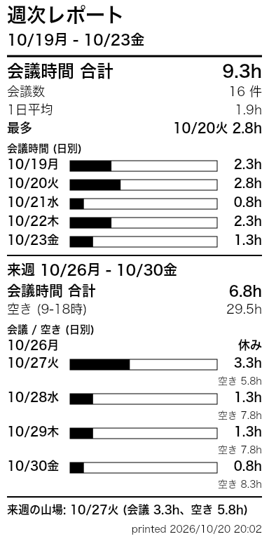
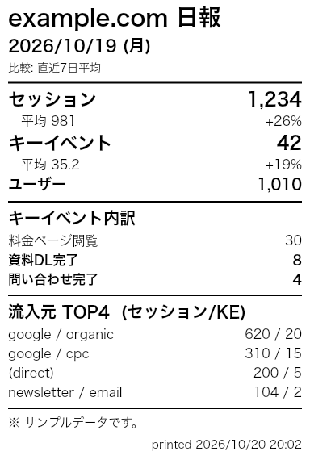

# receipt-printer

58mm (384dot) の ESC/POS レシートプリンタに、Google カレンダーや GA4 のレポートを USB で直接印刷する Bun + TypeScript 製ツール。

Claude などの AI エージェントが MCP 経由でカレンダー / GA4 のデータを取得して JSON にし、このツールに渡して印刷する使い方を想定している。

| 今日の予定 | 週次レポート | GA4 日報 |
|---|---|---|
|  |  |  |

## Web UI

```
bun install
bun run ui   # http://localhost:3939
```

レポート (今日の予定 / 週次 / GA4 日報 / メモ / JSON) を選んでプレビューし、ボタンで印刷する。メモは Markdown 風に書ける (`# 見出し` `- [ ] チェック` `左 | 右` `---`)。

## CLI

```
bun run receipt agenda   examples/events.json   2026-10-20   # 今日の予定
bun run receipt weekly   examples/events.json   2026-10-19   # 週次レポート (日付=その週のどこか)
bun run receipt ga-daily examples/ga-daily.json              # GA4 日報
bun run receipt blocks   any.json                           # Block[] をそのまま
```

`--preview` を付けると `out/<report>.png` だけ作って印刷しない。

## 構成

- `src/types.ts` — `Block` (レシートの部品) と `CalendarEvent`
- `src/render.ts` — `Block[]` → Canvas (384px 幅)
- `src/printer.ts` — Canvas → ESC/POS ラスタ、WebUSB 互換 API で送信
- `src/reports/*.ts` — データ → `Block[]` を作るレポート定義。新しいレポートは関数を書いて `reports/index.ts` に登録すると CLI と UI の両方に出る
- `src/server.ts` + `src/ui/` — Web UI (Bun.serve + HTML import)
- `examples/` — ダミーの入力データ
- `data/` — 実データ置き場 (gitignore 済み)

## 前提

- `brew install libusb` (macOS)
- プリンタの USB ID はデフォルト `0483:070B`。違う場合は環境変数で指定する

```
PRINTER_VID=0x0416 PRINTER_PID=0x5011 bun run receipt agenda examples/events.json
```
